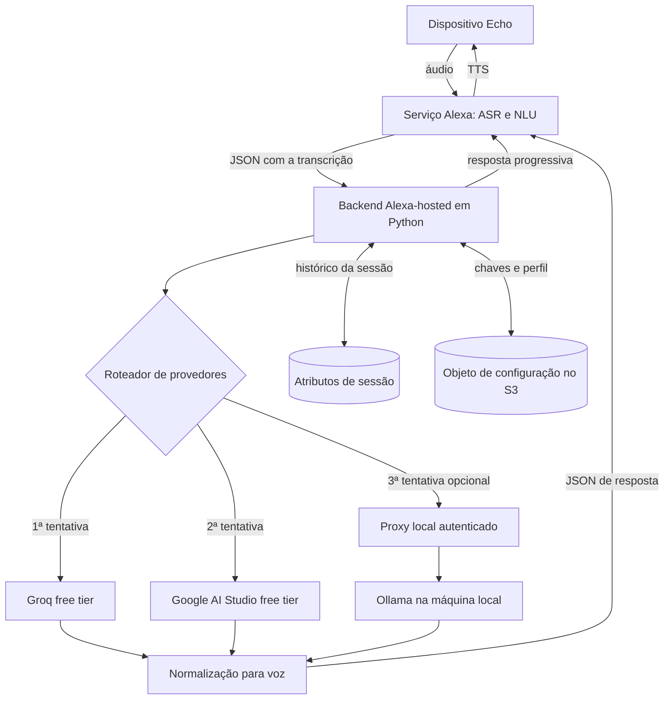

# SDD - Solution Design Document
## Assistente Conversacional na Alexa com LLM

---

### 1. Controle do documento

| Campo | Valor |
|---|---|
| Projeto | Assistente Conversacional na Alexa com LLM |
| Documento | SDD (Solution Design Document) |
| Versão | 1.0 |
| Data | 02/08/2026 |
| Autor | Luan Pacheco Cabral |
| Documento relacionado | PDD-assistente-alexa-llm.md |
| Restrição-mãe | Custo recorrente igual a zero |
| Status | Aprovado para execução |

---

### 2. Visão geral da solução

A solução mantém o pipeline de voz da Amazon (captura, reconhecimento e síntese) e substitui a camada de resolução de resposta por um LLM. O backend da skill deixa de ser uma máquina de estados sobre intents e passa a ser um orquestrador: extrai a fala transcrita, monta o contexto, escolhe um provedor de inferência, controla o prazo e devolve a resposta formatada para voz.

Duas decisões definem toda a arquitetura.

**Decisão 1: o backend roda como Alexa-hosted skill, não em conta AWS própria.**
Quando você cria uma skill como Alexa-hosted, a Amazon provisiona os recursos e absorve o custo. Segundo a documentação de limites de recursos hospedados, cada conta de desenvolvedor recebe requisições Lambda ilimitadas e gratuitas para o endpoint da skill, 25 GB de armazenamento no S3 com 250 GB de transferência de saída por mês, 25 GB no DynamoDB com 10 milhões de leituras e escritas mensais, e 50 GB-mês de repositório Git com 10 mil requisições. Não existe conta AWS vinculada, não existe cartão de crédito cadastrado, e portanto não existe caminho pelo qual uma fatura possa aparecer. Isso é estruturalmente mais seguro para a restrição de custo zero do que um free tier que apenas não cobra até certo ponto.

**Decisão 2: a inferência primária é feita em provedores de free tier permanente, com fallback em cadeia.**
Free tier gratuito de provedor único é um ponto de falha. A solução trata os provedores como uma fila ordenada e configurável, com prazo individual por chamada. Se o primeiro falhar por erro, cota ou latência, o segundo assume dentro do tempo restante. O endpoint local em Ollama entra como terceira posição opcional, nunca como primária, porque a latência de uma conexão residencial não é compatível com a janela de 8 segundos de forma confiável.

---

### 3. Matriz de custo zero

| Componente | Serviço | Como é gratuito | Limite relevante | Cartão exigido |
|---|---|---|---|---|
| Conta de desenvolvedor | Amazon Developer | Gratuita por definição | Não aplicável | Não |
| Runtime do backend | Alexa-hosted (Python) | Recursos provisionados pela Amazon | Requisições Lambda ilimitadas para o endpoint da skill | Não |
| Armazenamento de configuração | S3 do Alexa-hosted | Incluído na skill hospedada | 25 GB e 250 GB de saída por mês | Não |
| Persistência (v2) | DynamoDB do Alexa-hosted | Incluído na skill hospedada | 25 GB e 10M leituras/escritas por mês | Não |
| Versionamento | Repositório Git do Alexa-hosted | Incluído na skill hospedada | 50 GB-mês e 10 mil requisições Git | Não |
| Inferência primária | Groq, plano free | Free tier permanente sem créditos | Cerca de 30 requisições por minuto e da ordem de 1.000 por dia por modelo | Não |
| Inferência secundária | Google AI Studio, plano free | Free tier permanente | Varia por modelo, modelos Flash e Flash-Lite são os generosos, o Pro é bem restrito | Não |
| Inferência terciária (opcional) | Ollama local | Software livre em hardware próprio | Capacidade da máquina | Não |
| Exposição do endpoint local (opcional) | Tailscale Funnel, plano Personal | Gratuito para uso não comercial | Portas 443, 8443 e 10000, domínio no formato `*.ts.net` | Não |
| Observabilidade | Log da skill hospedada | Incluído | Não aplicável | Não |
| **Total mensal** | | | | **R$ 0,00** |

> Os limites de free tier dos provedores de LLM mudam com frequência. Os números acima refletem o que estava publicado na data de redação e servem para dimensionamento, não como contrato. Confira a página de rate limits do provedor antes de escolher o modelo. A volumetria do PDD (300 a 1.200 requisições por mês) fica muito abaixo de qualquer um desses limites.

**Componente descartado por custo:** Cloudflare Tunnel. A solução é tecnicamente excelente e resolve TLS, DDoS e autenticação por Service Token de forma elegante, mas exige um domínio próprio gerenciado pelo Cloudflare, e domínio é anuidade paga. Os túneis efêmeros do tipo `trycloudflare.com` são gratuitos, porém geram uma URL nova a cada reinício, o que quebra a configuração do backend. Por isso a trilha local usa Tailscale Funnel, que entrega hostname estável e certificado TLS válido sem domínio próprio.

---

### 4. Arquitetura

#### 4.1 Fluxo principal



#### 4.2 Camadas

| Camada | Responsabilidade | Onde roda |
|---|---|---|
| Interface de voz | Captura e síntese | Dispositivo Echo |
| Reconhecimento | ASR, NLU, resolução de intent e slot | Serviço Alexa |
| Orquestração | Extração, contexto, prazo, fallback, formatação | Backend Alexa-hosted |
| Inferência | Geração da resposta | Provedor externo ou máquina local |
| Estado | Histórico da sessão e configuração | Atributos de sessão e S3 |

#### 4.3 Orçamento de tempo

O serviço Alexa concede 8 segundos ao backend. A alocação é a seguinte.

| Etapa | Orçamento | Observação |
|---|---|---|
| Cold start do runtime | 0,0 a 1,2 s | Só na primeira invocação após ociosidade |
| Leitura da configuração | 0,0 a 0,2 s | Cacheada em variável de módulo entre invocações quentes |
| Montagem do contexto | menos de 0,05 s | Operação em memória |
| Resposta progressiva | 0,3 s | Chamada com timeout curto, falha é ignorada |
| Chamada ao LLM | até 5,0 s por provedor | Prazo dinâmico, reduzido pelo tempo já consumido |
| Normalização e retorno | menos de 0,05 s | Operação em memória |
| **Margem reservada** | **2,0 s** | Rede da Amazon e serialização |

O prazo total interno é 6,0 segundos. O roteador só tenta o provedor seguinte se restar pelo menos 1,5 segundo, caso contrário aborta e devolve a mensagem controlada da EX-03.

---

### 5. Modelo de interação

#### 5.1 O problema do carrier phrase

O plano original propunha uma intent com utterance `"{Query}"` para capturar qualquer fala. **Isso não compila.** O slot `AMAZON.SearchQuery` é um phrase slot, e a documentação de slot types da Alexa é explícita: cada sample utterance precisa incluir uma carrier phrase, ou seja, palavras fora do slot. O console rejeita a construção com erro do tipo `MissingCarrierPhraseWithPhraseSlot`. A restrição existe para impedir que um slot guloso engula as intents nativas.

Também vale registrar duas restrições correlatas: o `AMAZON.SearchQuery` não pode ser combinado com nenhum outro slot na mesma utterance, e deve aparecer no fim da frase, depois da carrier phrase.

#### 5.2 A solução: elicitação de slot

A documentação abre uma exceção importante: a carrier phrase pode ser omitida nos **slot samples**, que são as frases de exemplo definidas dentro da configuração de diálogo do slot, e não no nível da intent.

Isso resolve o problema de forma limpa. A estratégia é:

1. As utterances de nível de intent têm carrier phrase e servem apenas para a invocação inicial ("pergunte X", "me explique Y")
2. Os slot samples são apenas `{pergunta}`, sem carrier phrase
3. Ao fim de cada turno o backend devolve uma diretiva `Dialog.ElicitSlot` apontando para o slot de captura
4. Enquanto o slot está em elicitação, valem os slot samples, e portanto qualquer coisa que o usuário falar cai inteira dentro do slot

O resultado é um catch-all real a partir do segundo turno, sem gambiarra de slot customizado com milhares de valores.

#### 5.3 JSON do modelo de interação

```json
{
  "interactionModel": {
    "languageModel": {
      "invocationName": "meu assistente",
      "intents": [
        {
          "name": "PerguntaIntent",
          "slots": [
            { "name": "pergunta", "type": "AMAZON.SearchQuery" }
          ],
          "samples": [
            "pergunte {pergunta}",
            "me diga {pergunta}",
            "me explique {pergunta}",
            "quero saber {pergunta}",
            "responda {pergunta}",
            "sobre {pergunta}",
            "o que você acha de {pergunta}"
          ]
        },
        { "name": "AMAZON.StopIntent", "samples": [] },
        { "name": "AMAZON.CancelIntent", "samples": [] },
        { "name": "AMAZON.HelpIntent", "samples": [] },
        { "name": "AMAZON.FallbackIntent", "samples": [] }
      ],
      "types": []
    },
    "dialog": {
      "delegationStrategy": "SKILL_RESPONSE",
      "intents": [
        {
          "name": "PerguntaIntent",
          "confirmationRequired": false,
          "prompts": {},
          "slots": [
            {
              "name": "pergunta",
              "type": "AMAZON.SearchQuery",
              "confirmationRequired": false,
              "elicitationRequired": true,
              "prompts": { "elicitation": "Elicit.Slot.Pergunta" },
              "samples": ["{pergunta}"]
            }
          ]
        }
      ]
    },
    "prompts": [
      {
        "id": "Elicit.Slot.Pergunta",
        "variations": [
          { "type": "PlainText", "value": "O que você quer saber?" },
          { "type": "PlainText", "value": "Pode perguntar." }
        ]
      }
    ]
  }
}
```

Notas de implementação:

- `delegationStrategy: SKILL_RESPONSE` deixa o controle do diálogo com o backend, que é o que queremos
- O nome de invocação precisa ter duas ou mais palavras e não pode colidir com termos reservados da Alexa
- Se o build reclamar do `AMAZON.FallbackIntent` no locale pt-BR, remova a entrada, o restante do modelo não depende dela

---

### 6. Backend

#### 6.1 Estrutura de arquivos

```
lambda/
├── lambda_function.py     # handlers da skill
├── llm.py                 # roteador e clientes de provedor
├── voz.py                 # normalização de texto para fala
├── config.py              # carregamento de configuração do S3
└── requirements.txt
```

#### 6.2 requirements.txt

```
ask-sdk-core==1.19.0
boto3
```

O `boto3` já está presente no runtime, mas declarar explicita a dependência. Não é necessário adicionar bibliotecas HTTP: o `urllib.request` da biblioteca padrão dá conta e evita risco de incompatibilidade de versão no ambiente hospedado.

#### 6.3 config.py

```python
# -*- coding: utf-8 -*-
"""Carregamento da configuração a partir do bucket S3 da própria skill."""

import json
import os

import boto3

CHAVE_CONFIG = "config/llm.json"
_cache = None


def carregar():
    """Le a configuracao uma vez por container e mantem em cache."""
    global _cache
    if _cache is not None:
        return _cache

    bucket = os.environ["S3_PERSISTENCE_BUCKET"]
    cliente = boto3.client("s3")
    objeto = cliente.get_object(Bucket=bucket, Key=CHAVE_CONFIG)
    _cache = json.loads(objeto["Body"].read().decode("utf-8"))
    return _cache
```

`S3_PERSISTENCE_BUCKET` é injetada automaticamente pelo runtime das skills hospedadas. Você não precisa configurar nada.

#### 6.4 Arquivo de configuração (`config/llm.json` no S3)

```json
{
  "ordem": ["groq", "gemini"],
  "perfil": "O usuário se chama Luan, é cientista de dados e mora em Belo Horizonte. Ele prefere respostas diretas e sem rodeio.",
  "groq": {
    "api_key": "COLE_A_CHAVE_AQUI",
    "modelo": "llama-3.3-70b-versatile"
  },
  "gemini": {
    "api_key": "COLE_A_CHAVE_AQUI",
    "modelo": "gemini-2.5-flash"
  },
  "local": {
    "url": "https://sua-maquina.seu-tailnet.ts.net",
    "token": "TOKEN_LONGO_ALEATORIO",
    "modelo": "llama3.1:8b"
  }
}
```

Para ativar a trilha local basta trocar `"ordem"` para `["groq", "gemini", "local"]`. Nenhuma alteração de código é necessária, o que atende a RNF-06 e a RNF-08.

#### 6.5 llm.py

```python
# -*- coding: utf-8 -*-
"""Roteador de provedores de inferencia com fallback em cadeia."""

import json
import logging
import time
import urllib.error
import urllib.request

import config

logger = logging.getLogger(__name__)

PRAZO_TOTAL = 6.0        # RN-04
PRAZO_POR_PROVEDOR = 5.0
PRAZO_MINIMO = 1.5       # abaixo disso nao vale a pena tentar
MAX_TOKENS = 220


def _post_json(url, corpo, cabecalhos, timeout):
    dados = json.dumps(corpo).encode("utf-8")
    req = urllib.request.Request(url, data=dados, headers=cabecalhos, method="POST")
    with urllib.request.urlopen(req, timeout=timeout) as resposta:
        return json.loads(resposta.read().decode("utf-8"))


def _groq(cfg, mensagens, timeout):
    corpo = {
        "model": cfg["modelo"],
        "messages": mensagens,
        "max_tokens": MAX_TOKENS,
        "temperature": 0.6,
    }
    cabecalhos = {
        "Content-Type": "application/json",
        "Authorization": "Bearer " + cfg["api_key"],
    }
    dados = _post_json(
        "https://api.groq.com/openai/v1/chat/completions", corpo, cabecalhos, timeout
    )
    return dados["choices"][0]["message"]["content"]


def _gemini(cfg, mensagens, timeout):
    sistema = next((m["content"] for m in mensagens if m["role"] == "system"), None)
    conteudos = [
        {
            "role": "model" if m["role"] == "assistant" else "user",
            "parts": [{"text": m["content"]}],
        }
        for m in mensagens
        if m["role"] != "system"
    ]
    corpo = {
        "contents": conteudos,
        "generationConfig": {"maxOutputTokens": MAX_TOKENS, "temperature": 0.6},
    }
    if sistema:
        corpo["systemInstruction"] = {"parts": [{"text": sistema}]}

    url = (
        "https://generativelanguage.googleapis.com/v1beta/models/"
        + cfg["modelo"]
        + ":generateContent?key="
        + cfg["api_key"]
    )
    dados = _post_json(url, corpo, {"Content-Type": "application/json"}, timeout)
    return dados["candidates"][0]["content"]["parts"][0]["text"]


def _local(cfg, mensagens, timeout):
    corpo = {
        "model": cfg["modelo"],
        "messages": mensagens,
        "stream": False,
        "options": {"num_predict": MAX_TOKENS},
    }
    cabecalhos = {
        "Content-Type": "application/json",
        "Authorization": "Bearer " + cfg["token"],
    }
    dados = _post_json(
        cfg["url"].rstrip("/") + "/api/chat", corpo, cabecalhos, timeout
    )
    return dados["message"]["content"]


PROVEDORES = {"groq": _groq, "gemini": _gemini, "local": _local}


def gerar(mensagens, prazo_total=PRAZO_TOTAL):
    """Percorre a fila de provedores ate obter uma resposta valida."""
    cfg = config.carregar()
    inicio = time.time()
    ultimo_erro = None

    for nome in cfg["ordem"]:
        restante = prazo_total - (time.time() - inicio)
        if restante < PRAZO_MINIMO:
            logger.warning("Prazo esgotado antes de tentar %s", nome)
            break

        try:
            marca = time.time()
            texto = PROVEDORES[nome](
                cfg[nome], mensagens, min(restante, PRAZO_POR_PROVEDOR)
            )
            if not texto or not texto.strip():
                raise ValueError("resposta vazia")          # EX-06

            logger.info(
                "Provedor %s respondeu em %.2fs", nome, time.time() - marca
            )
            return texto.strip()

        except urllib.error.HTTPError as erro:              # EX-04 e EX-05
            ultimo_erro = erro
            logger.warning("Provedor %s retornou HTTP %s", nome, erro.code)
        except Exception as erro:                           # EX-02, EX-06, EX-09
            ultimo_erro = erro
            logger.warning("Provedor %s falhou: %s", nome, erro)

    raise RuntimeError("nenhum provedor respondeu: %s" % ultimo_erro)
```

#### 6.6 voz.py

```python
# -*- coding: utf-8 -*-
"""Normalizacao de texto gerado para reproducao em voz."""

import re

LIMITE = 600          # RN-05
MARCACAO = re.compile(r"[*_`#>\[\]]")
LINK = re.compile(r"https?://\S+")


def normalizar(texto, limite=LIMITE):
    texto = LINK.sub("", texto)
    texto = MARCACAO.sub("", texto)
    texto = re.sub(r"^\s*\d+\.\s*", "", texto, flags=re.MULTILINE)
    texto = " ".join(texto.split())

    if len(texto) <= limite:
        return texto

    corte = texto[:limite]
    fim = max(corte.rfind("."), corte.rfind("!"), corte.rfind("?"))
    return corte[: fim + 1] if fim > 150 else corte.rstrip() + "..."   # EX-07


def escapar_ssml(texto):
    return (
        texto.replace("&", "&amp;")
        .replace("<", "&lt;")
        .replace(">", "&gt;")
    )
```

#### 6.7 lambda_function.py

```python
# -*- coding: utf-8 -*-
"""Handlers da skill. Runtime: Alexa-hosted (Python)."""

import json
import logging
import time
import urllib.request

from ask_sdk_core.dispatch_components import (
    AbstractExceptionHandler,
    AbstractRequestHandler,
)
from ask_sdk_core.skill_builder import SkillBuilder
from ask_sdk_core.utils import is_intent_name, is_request_type
from ask_sdk_model import Intent
from ask_sdk_model.dialog import ElicitSlotDirective

import config
import llm
import voz

logger = logging.getLogger(__name__)
logger.setLevel(logging.INFO)

INTENT = "PerguntaIntent"
SLOT = "pergunta"
MAX_MENSAGENS = 6        # 3 pares de turno, RN-09

PROMPT_BASE = (
    "Você é um assistente pessoal falado, acessado por um dispositivo Alexa. "
    "Responda sempre em português do Brasil. "
    "Máximo de três frases. Vá direto ao ponto, sem introdução e sem resumo final. "
    "Nunca use listas, títulos, markdown, emoji ou qualquer formatação. "
    "Escreva números por extenso quando forem curtos. "
    "A transcrição de voz pode ter erros, interprete a intenção e não peça confirmação por isso. "
    "Se não souber, diga que não sabe em uma frase."
)


def montar_prompt_sistema():
    perfil = config.carregar().get("perfil", "")
    return PROMPT_BASE + (" " + perfil if perfil else "")


def elicitar():
    """Reabre o microfone com o slot limpo, garantindo captura livre no proximo turno."""
    return ElicitSlotDirective(
        slot_to_elicit=SLOT,
        updated_intent=Intent(name=INTENT, slots={}),
    )


def falar_espera(handler_input, texto="Só um instante."):
    """Resposta progressiva. Melhor esforco: qualquer falha e ignorada."""
    try:
        sistema = handler_input.request_envelope.context.system
        corpo = {
            "header": {
                "requestId": handler_input.request_envelope.request.request_id
            },
            "directive": {
                "type": "VoicePlayer.Speak",
                "speech": "<speak>%s</speak>" % voz.escapar_ssml(texto),
            },
        }
        req = urllib.request.Request(
            sistema.api_endpoint + "/v1/directives",
            data=json.dumps(corpo).encode("utf-8"),
            headers={
                "Content-Type": "application/json",
                "Authorization": "Bearer " + sistema.api_access_token,
            },
            method="POST",
        )
        urllib.request.urlopen(req, timeout=1.0)
    except Exception as erro:
        logger.info("Resposta progressiva ignorada: %s", erro)


class LaunchHandler(AbstractRequestHandler):
    def can_handle(self, handler_input):
        return is_request_type("LaunchRequest")(handler_input)

    def handle(self, handler_input):
        handler_input.attributes_manager.session_attributes["historico"] = []
        return (
            handler_input.response_builder
            .speak("Oi. Pode perguntar.")
            .ask("Estou ouvindo.")
            .add_directive(elicitar())
            .response
        )


class PerguntaHandler(AbstractRequestHandler):
    def can_handle(self, handler_input):
        return is_intent_name(INTENT)(handler_input)

    def handle(self, handler_input):
        inicio = time.time()

        slots = handler_input.request_envelope.request.intent.slots or {}
        slot = slots.get(SLOT)
        pergunta = slot.value.strip() if slot and slot.value else ""

        if not pergunta:                                              # EX-01
            return (
                handler_input.response_builder
                .speak("Não peguei. Pode repetir?")
                .ask("Pode repetir?")
                .add_directive(elicitar())
                .response
            )

        atributos = handler_input.attributes_manager.session_attributes
        historico = atributos.get("historico", [])

        mensagens = [{"role": "system", "content": montar_prompt_sistema()}]
        mensagens.extend(historico[-MAX_MENSAGENS:])
        mensagens.append({"role": "user", "content": pergunta})

        falar_espera(handler_input)

        restante = llm.PRAZO_TOTAL - (time.time() - inicio)
        if restante < llm.PRAZO_MINIMO:                               # EX-08
            texto = "Demorei demais aqui. Pergunta de novo?"
        else:
            try:
                texto = voz.normalizar(llm.gerar(mensagens, restante))
            except Exception as erro:                                 # EX-03
                logger.error("Falha em todos os provedores: %s", erro)
                texto = "Não consegui falar com o modelo agora. Tenta de novo?"
            else:
                historico.append({"role": "user", "content": pergunta})
                historico.append({"role": "assistant", "content": texto})
                atributos["historico"] = historico[-MAX_MENSAGENS:]

        logger.info("Turno concluído em %.2fs", time.time() - inicio)

        return (
            handler_input.response_builder
            .speak(texto)
            .ask("Mais alguma coisa?")
            .add_directive(elicitar())
            .response
        )


class EncerrarHandler(AbstractRequestHandler):
    def can_handle(self, handler_input):
        return is_intent_name("AMAZON.StopIntent")(handler_input) or is_intent_name(
            "AMAZON.CancelIntent"
        )(handler_input)

    def handle(self, handler_input):
        return handler_input.response_builder.speak("Até mais.").set_should_end_session(
            True
        ).response


class AjudaHandler(AbstractRequestHandler):
    def can_handle(self, handler_input):
        return is_intent_name("AMAZON.HelpIntent")(handler_input)

    def handle(self, handler_input):
        return (
            handler_input.response_builder
            .speak("Pode me perguntar qualquer coisa. Diga para quando quiser sair.")
            .ask("O que você quer saber?")
            .add_directive(elicitar())
            .response
        )


class FallbackHandler(AbstractRequestHandler):
    def can_handle(self, handler_input):
        return is_intent_name("AMAZON.FallbackIntent")(handler_input)

    def handle(self, handler_input):
        return (
            handler_input.response_builder
            .speak("Não entendi. Pode falar de novo?")
            .ask("Pode falar de novo?")
            .add_directive(elicitar())
            .response
        )


class SessaoEncerradaHandler(AbstractRequestHandler):
    def can_handle(self, handler_input):
        return is_request_type("SessionEndedRequest")(handler_input)

    def handle(self, handler_input):
        motivo = getattr(handler_input.request_envelope.request, "reason", None)
        logger.info("Sessão encerrada: %s", motivo)
        return handler_input.response_builder.response


class ErroGeralHandler(AbstractExceptionHandler):
    def can_handle(self, handler_input, exception):
        return True

    def handle(self, handler_input, exception):
        logger.exception("Erro não tratado: %s", exception)
        return (
            handler_input.response_builder
            .speak("Deu ruim aqui do meu lado. Tenta de novo?")
            .ask("Tenta de novo?")
            .add_directive(elicitar())
            .response
        )


sb = SkillBuilder()
sb.add_request_handler(LaunchHandler())
sb.add_request_handler(PerguntaHandler())
sb.add_request_handler(EncerrarHandler())
sb.add_request_handler(AjudaHandler())
sb.add_request_handler(FallbackHandler())
sb.add_request_handler(SessaoEncerradaHandler())
sb.add_exception_handler(ErroGeralHandler())

lambda_handler = sb.lambda_handler()
```

**Detalhe que costuma quebrar:** passar `ElicitSlotDirective` sem `updated_intent` faz a Alexa manter o valor anterior do slot preenchido. Se o turno seguinte não for reconhecido, o backend recebe a pergunta antiga de novo e responde duas vezes a mesma coisa. Por isso a função `elicitar()` envia sempre uma `Intent` nova com `slots={}`.

---

### 7. Gestão de contexto

| Nível | Onde vive | Escopo | Custo de latência |
|---|---|---|---|
| Histórico da conversa | Atributos de sessão (viajam no payload) | Sessão atual | Zero |
| Perfil do usuário | Objeto de configuração no S3, em cache no container | Permanente | Zero após o primeiro acesso |
| Memória de longo prazo | Não implementado na v1 | | |

A v1 usa apenas atributos de sessão. A escolha é deliberada: atributos de sessão trafegam dentro do próprio payload da Alexa e não custam nenhuma chamada de rede, enquanto persistência em S3 ou DynamoDB adiciona uma ida e volta por turno dentro de um orçamento de 8 segundos que já é apertado.

Quando a memória de longo prazo entrar (item B-01 do backlog), o caminho gratuito já está disponível: o `ask-sdk-s3-persistence-adapter` grava no bucket que a skill hospedada já provisiona, sem custo adicional.

---

### 8. Trilha B: inferência local (opcional)

Só faz sentido se você quiser privacidade total sobre o conteúdo das perguntas. Nunca deve ser o provedor primário, pela latência residencial.

#### 8.1 Por que não expor o Ollama diretamente

O Ollama não tem autenticação nativa. Expor a porta 11434 publicamente entrega o seu hardware para qualquer pessoa que encontrar o endereço. A solução tem duas camadas: um proxy local que exige token e o túnel que dispensa abrir portas no roteador.

#### 8.2 Proxy autenticado

```python
# -*- coding: utf-8 -*-
"""Proxy autenticado na frente do Ollama. Executar na maquina local."""

import os

import httpx
from fastapi import FastAPI, Header, HTTPException, Request
from fastapi.responses import JSONResponse

TOKEN = os.environ["PROXY_TOKEN"]
OLLAMA = "http://127.0.0.1:11434"

app = FastAPI()


@app.get("/health")
def health():
    return {"ok": True}


@app.post("/api/chat")
async def chat(requisicao: Request, authorization: str = Header(default="")):
    if authorization != "Bearer " + TOKEN:
        raise HTTPException(status_code=401, detail="nao autorizado")

    corpo = await requisicao.json()
    corpo["stream"] = False

    async with httpx.AsyncClient(timeout=20.0) as cliente:
        resposta = await cliente.post(OLLAMA + "/api/chat", json=corpo)

    return JSONResponse(status_code=resposta.status_code, content=resposta.json())
```

```bash
pip install fastapi uvicorn httpx
export PROXY_TOKEN="$(openssl rand -hex 32)"
uvicorn proxy:app --host 127.0.0.1 --port 8080
```

O proxy escuta apenas em `127.0.0.1`. Quem expõe é o túnel, e só a rota `/api/chat` existe.

#### 8.3 Túnel com Tailscale Funnel

```bash
# instalação
curl -fsSL https://tailscale.com/install.sh | sh    # Linux
brew install tailscale                              # macOS

sudo tailscale up

# exposição pública com TLS válido e hostname estável
sudo tailscale funnel --bg 8080
sudo tailscale funnel status
```

O comando devolve a URL no formato `https://sua-maquina.seu-tailnet.ts.net`. É essa URL que vai no campo `local.url` da configuração.

Pontos relevantes:

- O Funnel está disponível em todos os planos, incluindo o Personal gratuito, que cobre uso não comercial
- O TLS termina na sua máquina, os servidores de ingresso não veem o tráfego decifrado
- Só escuta em 443, 8443 e 10000, e só funciona sobre TLS
- É preciso habilitar o atributo `funnel` para o nó na política do tailnet antes do primeiro uso
- O registro DNS público pode levar alguns minutos para propagar

#### 8.4 Modelo recomendado para a trilha local

Com 8 segundos de janela e a latência da sua conexão no meio do caminho, o teto realista é um modelo de 7B a 8B quantizado, com a inferência inteiramente na GPU ou NPU e `num_predict` limitado. Modelos maiores tendem a estourar o timeout na primeira frase longa.

---

### 9. Segredos e configuração

Skills hospedadas não expõem configuração de variáveis de ambiente no console. Apenas as variáveis injetadas pelo runtime, como `S3_PERSISTENCE_BUCKET`, estão disponíveis. Isso descarta o caminho usual de guardar chave em variável de ambiente.

| Opção | Avaliação | Decisão |
|---|---|---|
| Constante no código | O repositório da skill hospedada é privado, mas a chave fica no histórico de commits e reaparece em qualquer clone ou download | Descartada |
| Objeto no S3 da própria skill | Fora do versionamento, criptografado em repouso, editável sem redeploy, custo zero dentro dos 25 GB | **Adotada** |
| AWS Secrets Manager | Solução correta, porém cobra por segredo armazenado | Descartada por custo |

**Como gravar o arquivo de configuração:** o bucket S3 da skill fica no painel de código do console de desenvolvedor, na aba de mídia da skill hospedada. Envie o arquivo `llm.json` para o prefixo `config/`. Alternativa por script, a partir de um trecho executado uma única vez no próprio backend, é gravar o objeto com `boto3` e depois remover o trecho.

Regras complementares:

- Nunca registrar o conteúdo da configuração em log (RN-13)
- Rotacionar as chaves substituindo o objeto no S3, sem redeploy, já que o cache morre junto com o container
- A chave do Groq e a do Google AI Studio são emitidas sem cartão de crédito, então uma chave vazada gera abuso de cota, não fatura

---

### 10. Prompt de sistema

O prompt é o componente que mais afeta a percepção de qualidade, e o segundo que mais afeta a latência (depois do modelo escolhido). Cada instrução tem uma função técnica.

| Instrução | Função |
|---|---|
| Máximo de três frases | Menos tokens gerados significa menos tempo até a resposta completa, é a mitigação mais eficaz do timeout |
| Sem introdução e sem resumo final | Elimina o desperdício de tokens em preâmbulo antes do conteúdo útil |
| Sem listas, títulos, markdown ou emoji | Marcação vira ruído quando lida em voz alta (RN-07) |
| Sempre em português do Brasil | Fixa o idioma independente do idioma da pergunta |
| Interprete erros de transcrição sem pedir confirmação | Evita o loop de "você quis dizer" causado por falha de ASR |
| Se não souber, diga em uma frase | Corta alucinação longa, que é cara em tempo e ruim em voz |

O perfil do usuário fica fora do código, no objeto de configuração, para ser ajustado sem redeploy.

---

### 11. Rastreabilidade de exceções

| ID (PDD) | Onde é tratado |
|---|---|
| EX-01 slot vazio | `PerguntaHandler`, verificação de `pergunta` |
| EX-02 timeout de provedor | `llm.gerar`, bloco `except Exception` |
| EX-03 todos falharam | `PerguntaHandler`, `except` sobre `llm.gerar` |
| EX-04 HTTP 429 | `llm.gerar`, bloco `except urllib.error.HTTPError` |
| EX-05 HTTP 401 e 403 | `llm.gerar`, mesmo bloco |
| EX-06 resposta vazia | `llm.gerar`, validação antes do retorno |
| EX-07 resposta longa demais | `voz.normalizar` |
| EX-08 prazo estourado antes da chamada | `PerguntaHandler`, verificação de `restante` |
| EX-09 endpoint local inacessível | `llm.gerar`, tratado como falha comum de provedor |
| EX-10 falha de configuração | `ErroGeralHandler` |

---

### 12. Observabilidade

O log do CloudWatch é acessível pelo próprio console de desenvolvedor, sem conta AWS. O que registrar:

| Evento | Nível | Conteúdo |
|---|---|---|
| Provedor respondeu | INFO | Nome do provedor e duração em segundos |
| Provedor falhou | WARNING | Nome, tipo de erro e código HTTP quando houver |
| Prazo esgotado | WARNING | Provedor que não chegou a ser tentado |
| Turno concluído | INFO | Duração total do handler |
| Erro não tratado | ERROR | Stack trace completo |

Nunca registrar: chaves de API, conteúdo do objeto de configuração, texto integral das perguntas.

A métrica que importa acompanhar é a duração por provedor. Se a mediana do primário passar de 3 segundos de forma consistente, inverta a ordem da fila. É uma alteração de configuração, não de código.

---

### 13. Plano de implantação

| Fase | Entrega | Validação | Esforço |
|---|---|---|---|
| 0 | Contas criadas: Amazon Developer, Groq, Google AI Studio | Chaves em mãos | 30 min |
| 1 | Skill criada como Alexa-hosted (Python), locale pt-BR | Skill aparece no console | 20 min |
| 2 | Modelo de interação publicado | Build sem erro de carrier phrase | 40 min |
| 3 | Backend em modo eco, devolvendo a fala capturada sem LLM | Loop de elicitação funciona por 3 turnos seguidos | 40 min |
| 4 | Objeto de configuração gravado no S3 | Leitura confirmada em log | 20 min |
| 5 | Integração com o provedor primário | CA-01 e CA-02 atendidos | 1 h |
| 6 | Fila de fallback e resposta progressiva | CA-04 atendido com chave primária invalidada | 1 h |
| 7 | Teste no dispositivo físico | CA-03, CA-06, CA-07, CA-08, CA-09 | 40 min |
| 8 (opcional) | Trilha local: proxy, túnel e ativação na fila | Chamada autenticada respondendo | 2 h |

**Esforço total:** cerca de 5 horas para a trilha principal, 7 horas com a trilha local.

A fase 3 existe por um motivo específico: o loop de elicitação de slot é a parte mais frágil do desenho, e vale isolá-la antes de somar a latência e a variabilidade do LLM. Se a captura livre não estiver funcionando no modo eco, o problema é do modelo de interação e não do backend.

**Pré-requisito importante:** a skill em modo desenvolvimento fica disponível nos dispositivos vinculados à mesma conta Amazon usada na conta de desenvolvedor. Se o Echo estiver em outra conta, a skill não aparece, e não existe certificação a fazer nesse caso, é só questão de conta.

---

### 14. Plano de testes

| ID | Teste | Como executar | Resultado esperado |
|---|---|---|---|
| T-01 | Build do modelo de interação | Salvar e construir no console | Build sem erro de carrier phrase |
| T-02 | Captura livre no primeiro turno | Invocar com carrier phrase | Slot preenchido com a frase completa |
| T-03 | Captura livre nos turnos seguintes | Falar sem carrier phrase após a primeira resposta | Slot preenchido, sem cair no fallback |
| T-04 | Continuidade de contexto | Perguntar algo e depois "e por quê?" | Resposta coerente com o turno anterior |
| T-05 | Limite de contexto | Encadear 6 turnos | Sem degradação e sem crescimento de latência |
| T-06 | Fallback de provedor | Corromper a chave primária no S3 | Resposta normal, com WARNING no log |
| T-07 | Falha total | Corromper todas as chaves | Mensagem controlada da EX-03 |
| T-08 | Cold start | Aguardar 30 min de ociosidade e invocar | Resposta dentro dos 8 segundos |
| T-09 | Truncamento | Pedir explicitamente uma resposta longa | Corte em ponto final, sem frase pela metade |
| T-10 | Marcação em voz | Pedir uma lista de itens | Fala corrida, sem ler asterisco ou numeração |
| T-11 | Encerramento | Dizer "para" | Despedida e fim da sessão, sem chamada ao LLM |
| T-12 | Silêncio | Não responder ao reprompt | Sessão encerra sozinha, sem erro no log |
| T-13 | Trilha local sem token | Chamar a URL do túnel sem header | HTTP 401 |
| T-14 | Trilha local com token | Chamar com o header correto | Resposta do modelo local |

---

### 15. Decisões de arquitetura

| ID | Decisão | Motivo | Custo aceito |
|---|---|---|---|
| ADR-01 | Alexa-hosted em vez de conta AWS própria | Sem cartão vinculado, logo sem caminho para fatura, e requisições Lambda ilimitadas para o endpoint da skill | Sem variáveis de ambiente configuráveis, runtime gerenciado pela Amazon |
| ADR-02 | Cloudflare Tunnel descartado, Tailscale Funnel adotado | Cloudflare Tunnel exige domínio próprio, que é pago | Hostname no formato `*.ts.net` em vez de domínio próprio |
| ADR-03 | Autenticação local por token em proxy próprio | O Funnel não oferece equivalente ao Service Token do Cloudflare Access | Uma camada de código a mais para manter |
| ADR-04 | Provedores em nuvem como primários, local como terciário | Orçamento de 8 segundos não tolera latência residencial de forma confiável | Conteúdo das perguntas trafega para terceiros na configuração padrão |
| ADR-05 | Elicitação de slot em vez de utterance sem carrier phrase | Restrição documentada do phrase slot, que impede utterance formada só pelo slot | Um turno inicial precisa de carrier phrase |
| ADR-06 | Memória só de sessão na v1 | Cada leitura persistente consome parte do orçamento de 8 segundos | Assistente não lembra de nada entre sessões |
| ADR-07 | Segredos em objeto S3 da própria skill | Fora do versionamento, sem custo, rotação sem redeploy | Uma chamada extra no primeiro acesso de cada container |
| ADR-08 | Sem streaming de resposta | A Alexa opera em request/response síncrono | Toda a resposta precisa ser gerada antes de qualquer fala |
| ADR-09 | Fila de provedores em configuração, não em código | Troca de provedor sem redeploy, atende RNF-06 e RNF-08 | Configuração precisa ser validada manualmente |
| ADR-10 | `urllib` em vez de `requests` ou SDKs de provedor | Biblioteca padrão, sem risco de incompatibilidade no ambiente hospedado e sem peso de pacote | Código de cliente HTTP escrito à mão |

---

### 16. Referências

| Assunto | Fonte |
|---|---|
| Limites de recursos de skills hospedadas | Documentação de usage limits on hosted resources, Alexa Skills Kit |
| Restrição de carrier phrase em phrase slots | Documentação de slot type reference e de tips for using built-in slots, Alexa Skills Kit |
| Timeout de 8 segundos do endpoint | Documentação de troubleshooting e boas práticas do Alexa Skills Kit |
| Resposta progressiva | Documentação da Progressive Response REST API, com limite de cinco respostas por requisição |
| Free tier do Groq | Página de rate limits do GroqCloud |
| Free tier do Google AI Studio | Página de rate limits da Gemini API |
| Tailscale Funnel | Documentação do Tailscale Funnel e página de planos |

---

### 17. Checklist de conclusão

- [ ] Contas criadas e chaves emitidas
- [ ] Skill hospedada criada em pt-BR
- [ ] Modelo de interação construído sem erro
- [ ] Loop de elicitação validado em modo eco
- [ ] Objeto de configuração gravado no S3
- [ ] Provedor primário respondendo dentro de 5 segundos
- [ ] Fila de fallback testada com chave inválida
- [ ] Resposta progressiva audível no dispositivo
- [ ] Todos os critérios de aceite do PDD verificados
- [ ] Nenhum serviço com cartão de crédito vinculado
