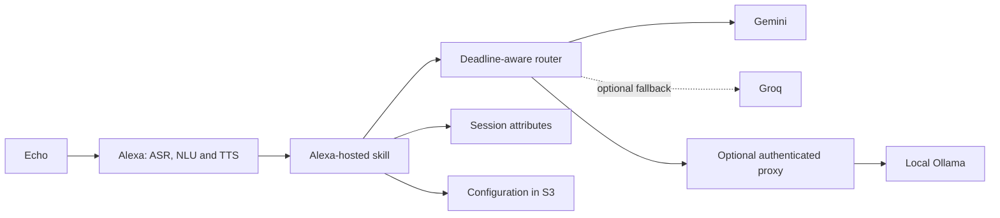

# Alexa Conversational Assistant with an LLM

**English** · [Português](README.pt-BR.md)

An Alexa-hosted skill in Brazilian Portuguese that uses Alexa for speech (ASR, NLU and TTS)
and a large language model to generate conversational answers. The backend is designed to run
with no recurring cost, using configurable free-tier providers with a fallback chain.

## Release status

The current version is `0.1.2`. The pt-BR Alexa-hosted skill is deployed in the Alexa
Developer Console with standard Alexa responses and no dialog directives (the hosted endpoint
rejected them on a physical Echo). The voice test must be repeated after deploying this version.

## Architecture



Design points that are visible in the code:

- **Hard time budget.** Alexa gives a skill about eight seconds to answer. The router in
  `lambda/llm.py` spends at most 6 s in total and 5 s per provider, and skips a provider when
  less than 1.5 s remains, so a slow provider degrades into a controlled "unavailable" message
  instead of a timeout.
- **Provider fallback chain.** Gemini, Groq and a local Ollama behind an authenticated proxy are
  tried in the configured order.
- **Validated configuration.** `lambda/config.py` validates the external JSON configuration
  before use; keys live in S3, never in Git.
- **Speech-safe output.** `lambda/voz.py` normalizes and length-limits the model output and
  escapes it for SSML.

## Repository layout

```text
lambda/                 Backend deployed to the Alexa-hosted skill
models/                 pt-BR interaction model to import in the console
local_proxy/            Optional FastAPI proxy for a local Ollama
config/                 Safe example of the external configuration
tests/                  Unit tests and local integration tests
docs/                   Deployment guide, manual tests and release notes
Memory/                 Product (PDD) and design (SDD) documents, in Portuguese
```

## Local development

Requires Python 3.11 or later.

```powershell
py -3.11 -m venv .venv
.\.venv\Scripts\Activate.ps1
python -m pip install --upgrade pip
pip install -r requirements-dev.txt
pytest
ruff check .
```

CI (`.github/workflows/ci.yml`) runs `ruff check` and `pytest` on Python 3.11 for every push
and pull request.

The code in `lambda/` is loaded by the Alexa-hosted runtime, currently Python 3.8. Tests add
that directory to `sys.path` only for local runs. Types evaluated at import time must use
`typing`, not `collections.abc` generics that this runtime does not support.

## Configuration and secrets

1. Create an **Alexa-hosted (Python)** skill in the Alexa Developer Console, locale pt-BR.
2. Import `models/pt-BR.json` under **Build > Interaction Model > JSON Editor** and build the model.
3. Copy the files in `lambda/` to the skill's hosted repository, keeping the names at the root of
   the Lambda code.
4. Copy `config/llm.example.json`, fill in the keys and upload the result as `config/llm.json`
   to the S3 bucket provisioned for the skill. If the Alexa-hosted S3 panel is unavailable, use
   `lambda/config/llm.json` only in the skill's private hosted repository; never push it to GitHub.

The real `config/llm.json` is ignored by Git. Never put keys in the Git repository, in Git
history or in logs. The full procedure is in [docs/implantacao.md](docs/implantacao.md)
(Portuguese).

## Usage

After invoking the skill, say one of the carrier phrases, for example "pergunte qual a capital
de Minas Gerais" ("ask what the capital of Minas Gerais is"). Each new turn must start with a
carrier phrase such as "pergunte ...". Say "para" or "cancela" to stop.

## Known limitations

- Alexa requires a carrier phrase on every turn. This trade-off removes the dialog directive
  that the Alexa-hosted endpoint rejected on the Echo.
- The eight-second budget is imposed by Alexa. Slow providers, cold starts or network latency
  can still lead to the controlled unavailability message.
- Memory is limited to the current session; nothing is retained across sessions.
- Free tiers, provider policies and model compatibility change. Review the limits before deploying.
- The Ollama path is optional, can exceed the deadline and requires the authenticated proxy plus
  Tailscale Funnel. Never expose port 11434 directly.
- The Lambda response was validated in the console's manual test; voice tests in the simulator
  and on a physical Echo still depend on those tools and the device being available.
- Gemini is the active provider in the development configuration. Groq returned HTTP 403 during
  direct validation and was removed from the order until the account is authorized.
- There is no automated evaluation of answer quality; validation is manual
  ([docs/validacao-manual.md](docs/validacao-manual.md)).

## Branching and versioning

`main` holds stable releases, `develop` is the integration branch and `fix/*` branches carry
isolated fixes. Versions are recorded in `VERSION`, `CHANGELOG.md` and `docs/releases/`.

## Reference documents (Portuguese)

- [PDD](Memory/PDD-assistente-alexa-llm.md)
- [SDD](Memory/SDD-assistente-alexa-llm.md)
- [Deployment](docs/implantacao.md)
- [Manual validation](docs/validacao-manual.md)
- [Troubleshooting](docs/troubleshooting.md)

## License

Code released under the [MIT License](LICENSE).
