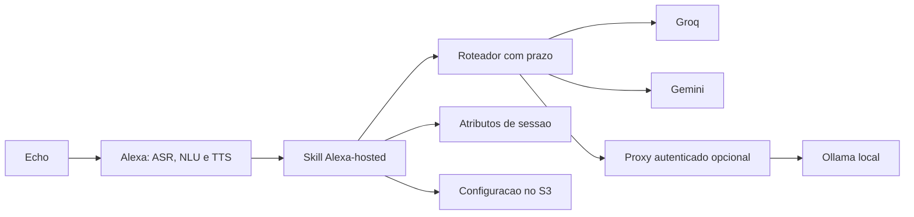

# Assistente Conversacional Alexa com LLM

Skill Alexa-hosted, em pt-BR, que usa a Alexa para voz e um LLM para gerar respostas conversacionais. O backend foi desenhado para operar sem custo recorrente, usando provedores configuráveis de free tier e fallback em cadeia.

## Estado da versão

A versão atual é `0.1.2`. A skill Alexa-hosted em pt-BR foi implantada no Alexa Developer Console com respostas padrão da Alexa, sem diretivas de diálogo incompatíveis. O teste de voz deve ser repetido após o deploy desta versão.

## Arquitetura



## Estrutura

```text
lambda/                 Backend a ser enviado para a Alexa-hosted skill
models/                 Modelo de interação pt-BR para importar no console
local_proxy/            Proxy FastAPI opcional para Ollama local
config/                 Exemplo seguro da configuração externa
tests/                  Testes unitários e de integração local
docs/                   Guia de implantação, testes manuais e releases
```

## Desenvolvimento local

Requer Python 3.11 ou superior.

```powershell
py -3.11 -m venv .venv
.\.venv\Scripts\Activate.ps1
python -m pip install --upgrade pip
pip install -r requirements-dev.txt
pytest
ruff check .
```

O código em `lambda/` é carregado pelo runtime Alexa-hosted. Os testes adicionam esse diretório ao `sys.path` apenas para execução local.

## Configuração e segredos

1. Crie uma skill **Alexa-hosted (Python)** no Alexa Developer Console, locale pt-BR.
2. Importe `models/pt-BR.json` na aba **Build > Interaction Model > JSON Editor** e construa o modelo.
3. Copie os arquivos de `lambda/` para o repositório hospedado da skill, preservando os nomes na raiz do código Lambda.
4. Copie `config/llm.example.json`, preencha as chaves e envie o resultado como `config/llm.json` para o bucket S3 provisionado pela skill. Se o painel S3 da Alexa-hosted estiver indisponível, use `lambda/config/llm.json` apenas no repositório privado hospedado da skill; nunca o envie ao GitHub.

O arquivo real `config/llm.json` é ignorado pelo Git. Nunca coloque chaves no repositório Git, no histórico Git ou em logs. O caminho `lambda/config/llm.json` é exclusivamente a contingência para o repositório privado Alexa-hosted. Veja o procedimento completo em [docs/implantacao.md](docs/implantacao.md).

## Uso

Após invocar a skill, diga uma das frases iniciais, por exemplo: “pergunte qual a capital de Minas Gerais”. Em cada novo turno, use novamente uma frase inicial como “pergunte ...”. Diga “para” ou “cancela” para encerrar.

## Limitações conhecidas

- A Alexa exige uma frase portadora em cada turno. Essa escolha elimina a diretiva de diálogo que o endpoint Alexa-hosted rejeitou no Echo.
- O orçamento rígido de oito segundos é externo à aplicação. Provedores lentos, cold start ou rede podem levar à mensagem controlada de indisponibilidade.
- A memória é apenas da sessão atual; não há retenção entre sessões nesta versão.
- Free tiers, políticas de provedores e compatibilidade de modelos mudam. Revise limites antes do deploy.
- A trilha Ollama é opcional, pode exceder o prazo e exige proxy autenticado mais Tailscale Funnel. Nunca exponha a porta 11434 diretamente.
- A resposta da Lambda foi validada no teste manual do console; o teste de voz no simulador e em Echo físico ainda depende da disponibilidade dos respectivos controles e dispositivo.
- Como contingência para falha do painel S3, a configuração ativa está no repositório privado Alexa-hosted. Mova-a para S3 e rotacione as chaves quando o painel voltar a funcionar.

## Versionamento local

O fluxo usa `main` para versões estáveis, `develop` para integração e branches `fix/*` para correções isoladas. As versões estão registradas em `VERSION`, `CHANGELOG.md` e `docs/releases/`.

## Documentos de referência

- [PDD](Memory/PDD-assistente-alexa-llm.md)
- [SDD](Memory/SDD-assistente-alexa-llm.md)
- [Implantação](docs/implantacao.md)
- [Validação manual](docs/validacao-manual.md)
